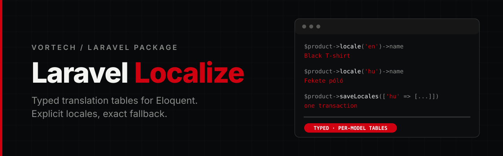

<p align="center">
  
</p>

<p align="center">
  <a href="https://github.com/Vortech-Group/localize/actions/workflows/tests.yml"></a>
  <a href="https://packagist.org/packages/vortech/laravel-localize"></a>
  <a href="https://packagist.org/packages/vortech/laravel-localize"></a>
  <a href="https://packagist.org/packages/vortech/laravel-localize"></a>
  
  <a href="LICENSE.md"></a>
</p>

<p align="center">
  <strong>Typed translation tables</strong> for Eloquent models: one table per model with real columns.<br>
  An explicit locale view with exact fallback rules, partial transactional saves and a per-locale unique rule.
</p>

---

## Why

Translations in a JSON column are hard to index, hard to constrain and hard to query. Localize gives every model its own translation table with ordinary columns, so a slug gets a unique index per locale and a description can be `text`.

| | JSON column | Localize |
|---|---|---|
| Unique slug per locale | no index to lean on | a normal unique index, plus the `UniqueTranslation` rule |
| Column types | everything is JSON | `string`, `text`, whatever your migration says |
| Reading | `$model->name` and a guess about the locale | `$model->locale('en')->name`, always explicit |
| Fallback | whatever the package decided | requested locale, then the app locale, then `null`, per column |
| Saving | rewrite the whole blob | only the submitted columns, in one transaction |
| Translation classes | one per model | none |

## Requirements

- PHP 8.4+
- Laravel 13+

## Installation

```bash
composer require vortech/laravel-localize
php artisan localize:install
```

`localize:install` publishes `config/localize.php`. The service provider is discovered automatically.

## Usage

### 1. Declare the model

```php
use Illuminate\Database\Eloquent\Model;
use Vortech\Localize\Attributes\Localized;
use Vortech\Localize\HasLocales;

#[Localized('slug', 'name', 'description')]
class Product extends Model
{
    use HasLocales;

    protected $fillable = ['sku', 'price', 'stock'];
}
```

The listed columns are not part of the model's `$fillable`: they live in the translation table and are checked against the attribute's whitelist.

### 2. Create the tables

```bash
php artisan localize:table Product
php artisan localize:table              # asks which model, from the ones in app/ that use HasLocales
```

generates the migration below from the model: the table name, the key type (`foreignId`, `foreignUlid` or `foreignUuid`), a nullable `string` per declared column (`text` for `body`, `content`, `description`, `excerpt`, `notes`, `summary` and `text`), the `(product_id, locale)` unique index and, with `#[LocalizedSlug]`, the `(locale, slug)` one. Check the column types before you migrate. It accepts a class name or a short name from `App\Models`, and `--force` replaces a migration generated before. Written by hand it looks like this:

The schema is yours, in a migration you version. The translation table is the singular of the model's table plus `_translations`, with the model's foreign key (`product_id`).

```php
Schema::create('product_translations', function (Blueprint $table): void {
    $table->id();

    $table->foreignId('product_id')->constrained('products')->cascadeOnDelete();

    $table->string('locale', 35);
    $table->string('slug')->nullable();
    $table->string('name')->nullable();
    $table->text('description')->nullable();
    $table->timestamps();

    $table->unique(['product_id', 'locale']);
    $table->unique(['locale', 'slug']);
});
```

- `unique(['product_id', 'locale'])` is required: one row per model and locale.
- Translatable columns should be nullable, so partial translations can be saved.
- For UUID/ULID models use `foreignUlid()` / `foreignUuid()`.
- To name every table differently change `table_suffix` in the config. For one irregular model override `getTranslationTable()` and `getTranslationForeignKey()`.

### 3. Read

```php
$product->locale()->name;                         // in the app locale
$product->locale('en')->name;                     // in English, falling back to the app locale
$product->locale('en', fallback: false)->name;    // only what is stored for English, else null
```

Fallback works per column. With `hu` as the app locale:

```php
// hu: name = 'Fekete póló', description = 'Pamut póló'
// en: name = 'Black T-shirt', description = null

$product->locale('en')->name;                          // Black T-shirt
$product->locale('en')->description;                   // Pamut póló
$product->locale('de')->name;                          // Fekete póló
$product->locale('en', fallback: false)->description;  // null
```

| Stored value | Result |
| --- | --- |
| row missing, or the column is `null` | fallback to the app locale |
| `''` | `''` |
| `'0'` | `'0'` |
| missing in the app locale too | `null` |

`app.fallback_locale` is not a step, and there is no `en-GB` → `en` or "first existing language" fallback. Reading an undeclared column throws `UnknownTranslationAttribute`.

**Reading as a property.** `$product->name` is not translated unless the model opts in:

```php
#[Localized('slug', 'name', 'description', magic: true)]
class Product extends Model { use HasLocales; }

$product->name;                  // the same as $product->locale()->name (the current app locale)
$product->locale('hu')->name;    // an explicit locale keeps working
$product->name = 'x';            // LogicException: write with locale()->update() or saveLocales()
```

Reading `$product->name` goes through the `locales` relation like any view, so eager load it in lists (lazy loading rules apply). Assigning is refused because the column does not exist on the model's own table. A real attribute of the same name with a value wins, so do not keep a translated column on the main table. The array form, `$fillable` and the dirty attributes never see the column.

A view fixes the requested locale and the app locale when it is created. A later `app()->setLocale()` does not change it.

### 4. Write

```php
// one locale, saved immediately
$product->locale('en')->update([
    'name' => 'Black T-shirt',
    'slug' => 'black-t-shirt',
]);

// several locales, in one transaction
$product->saveLocales([
    'hu' => ['name' => 'Fekete póló'],
    'en' => ['name' => 'Black T-shirt', 'description' => null],
]);
```

| Input | Effect |
| --- | --- |
| omitted locale or column | unchanged |
| `null` | clears that column |
| `''` | stores an empty string |
| new locale | creates the row |
| `[]` | no-op |
| unknown column, wrong shape or value type | exception, nothing is written |

Both calls use the same writer. The payload is validated before the first query, everything runs in one transaction on the model's connection, and only the submitted columns are written. Locale keys are used exactly as given (`en-GB` and `pt_BR` both work). A fallback value is never copied into a locale.

The model must be saved first (`UnsavedTranslationOwner` otherwise), and the package never saves the model's own pending changes. To create a model and its translations together, wrap both in your own transaction:

```php
$product = DB::transaction(fn (): Product => Product::create([...])->saveLocales([
    'hu' => ['name' => 'Fekete póló', 'slug' => 'fekete-polo'],
    'en' => ['name' => 'Black T-shirt', 'slug' => 'black-t-shirt'],
]));
```

Rows are inserted or updated, never upserted. On MySQL an upsert reacts to any unique index, so a slug clash could overwrite another product's row; here a clash raises a `QueryException` and the whole call rolls back. Two requests creating the same locale row for the first time at the same moment can also end in that exception: the unique index decides, and the loser should retry. There are no model events on the translation rows.

### 5. Validate

Which languages and columns are required is your Form Request's decision. The package validates only the technical shape. For uniqueness per locale:

```php
use Vortech\Localize\Rules\UniqueTranslation;

// a fixed locale
'slug' => ['bail', 'required', 'string', 'max:255',
    UniqueTranslation::for(Product::class, 'slug')->locale('en')],

// on update: the shorthand ignores the model itself
'slug' => ['bail', 'required', 'string', $product->locale('en')->unique('slug')],

// a bulk payload: the locale comes from the wildcard
'translations.*.slug' => ['bail', 'sometimes', 'nullable', 'string', 'max:255',
    UniqueTranslation::for(Product::class, 'slug')
        ->localeFrom('translations.*.slug')
        ->ignore($product)],
```

- It checks stored rows of the target locale, with no fallback. The same value in another locale is fine.
- It does not make a field required, and `null`, `''` and missing values are skipped without a query.
- `localeFrom()` takes a pattern with exactly one `*`. A pattern that does not match the attribute, or `locale()` combined with `localeFrom()`, is a configuration error, never a silent fallback to the app locale.
- `ignore()` takes a saved model of the same type and excludes it by the translation table's foreign key. Pass a model from route binding, never an id from the request.
- `where()`, `whereNot()`, `whereNull()` and `whereNotNull()` add conditions on translation table columns. They only help if your unique index has the same scope.
- Case sensitivity follows the database collation.
- The rule does not replace the unique index: a concurrent write can still win between validation and save.

### 6. Eager loading

`locales()` is a normal `HasMany` of the stored rows. The view reads the loaded relation, so after eager loading there are no queries per model:

```php
$products = Product::query()->with('locales')->get();

foreach ($products as $product) {
    echo $product->locale('en')->name;
}
```

To load fewer rows, include every locale you read plus the app locale you fall back to:

```php
$locales = array_values(array_unique(['en', app()->getLocale()]));

Product::query()->with(['locales' => fn ($query) => $query->whereIn('locale', $locales)])->get();
```

If the relation is not loaded, the normal Laravel lazy loading rules apply, including `Model::preventLazyLoading()`. After a save, a loaded relation is reloaded; after `refresh()` the next read is current. A change made by another process or rolled back by an outer transaction is not seen until you reload.

### 7. Serialize and edit

```php
$product->locale('en')->toArray();   // ['slug' => ..., 'name' => ..., 'description' => ...]

// edit forms: no fallback, so a fallback text is not mistaken for a finished translation
$form = [
    'hu' => $product->locale('hu', fallback: false)->toArray(),
    'en' => $product->locale('en', fallback: false)->toArray(),
];
```

The view is `Arrayable`, `Jsonable` (`toJson()`) and `JsonSerializable`, with the declared columns in declaration order. The model's own `toArray()` is untouched; in an API resource add `'translation' => $this->resource->locale()->toArray()`.

### 8. Query

Filtering by a translated column is explicit, in the locale you name:

```php
Product::query()
    ->whereLocale('en', fn ($query) => $query->where('slug', 'black-t-shirt'))
    ->withLocales()
    ->firstOrFail();

Product::query()->whereLocale('de')->get();       // models that have a German row at all
```

`whereLocale()` matches stored rows only: display fallback never changes what a query finds. The callback receives the translation table query. `withLocales()` eager loads the stored rows; `withLocales(['en'])` loads only those locales plus the current app locale, which the fallback reads. Both are Eloquent scopes, so they chain with anything and work on relations. Underneath it is a plain `whereHas('locales', ...)` / `with('locales')` if you prefer that.

Route model binding by a translated slug is described under Slugs.

### 9. Deleting

Deleting a model removes its translations through the foreign key's `cascadeOnDelete()`. With soft deletes the translations stay and are used again after `restore()`. Setting a column to `null` does not delete the row.

### 10. Factories

`withLocales()` is added to every Eloquent factory. It saves the locales right after the model is created, for each model of a batch:

```php
Product::factory()->withLocales([
    'hu' => ['name' => 'Fekete póló'],
    'en' => ['name' => 'Black T-shirt'],
])->create();

Product::factory()->withLocales(['hu', 'en'], ['name' => 'Póló'])->create();                  // same values for each locale
Product::factory()->withLocales(['hu', 'en'], [['name' => 'Póló'], ['name' => 'Tee']])->create(); // one entry per locale
```

With `make()` nothing is saved, because the model does not exist yet.

### 11. Locale routes

`Route::localized()` wraps routes in a `{locale}` URL prefix and the `SetLocale` middleware:

```php
Route::localized(function (): void {
    Route::get('products/{product}', [ProductController::class, 'show'])->name('products.show');
});
// /hu/products/1, /en/products/1, /pt_BR/products/1 ...

Route::localized(fn () => ..., ['hu', 'en']);   // locales for this group only
```

- The accepted locales are `localize.locales` (default `['en']`, so set it), matched exactly. Anything else is a 404, the same way as a missing route.
- `SetLocale` calls `app()->setLocale()`, so `locale()`, validation messages and dates follow the URL. It runs before route model binding, so a binding that reads the locale sees the right one.
- It also sets `URL::defaults(['locale' => ...])`: `route('products.show', $product)` keeps the current locale without passing it, and `route('products.show', [$product, 'locale' => 'en'])` links to another one.
- The `locale` parameter is removed from the route, so controllers and `Request::route()->parameters()` never see it.
- Using `SetLocale` on a route without a `{locale}` parameter throws `InvalidTranslationDefinition`.

Redirecting `/` to a locale and detecting it from `Accept-Language` are yours to add.

### 12. Slugs

`#[LocalizedSlug]` generates the slug of each locale from another column, unique per locale:

```php
#[Localized('slug', 'title', 'body')]
#[LocalizedSlug(from: 'title', to: 'slug')]   // these are the defaults 'name' and 'slug'
class Article extends Model
{
    use HasLocales;
}

$article->saveLocales(['hu' => ['title' => 'Fekete póló']]);   // slug: fekete-polo
```

- A slug is generated when a save sets `from`, leaves `to` out, and the locale has no slug yet. Later title changes keep the slug, so URLs stay stable; `regenerate: true` makes it follow the title instead.
- A slug you pass is stored as given, and an explicit `null` clears it. Your Request rules (`UniqueTranslation`) still decide whether a hand-written slug is valid.
- Transliteration follows the locale (`hu`: `póló` → `polo`, `de`: `Grüße` → `gruesse`); `pt_BR` and `en-GB` use their language.
- If another model already has the slug in the same locale, `-2`, `-3`, ... is added. The same title in another locale is not a clash.
- Generation checks the slug table first and the unique index decides in the end: two requests saving the same new title at the same moment can still end in a `QueryException`.
- Both columns must be declared with `#[Localized]`.

### 13. Routing by slug

On a model with `#[LocalizedSlug]` the slug is the route key, so `{article}` binds by the slug **in the URL's locale** (no fallback) and the model comes back with its `locales` loaded:

```php
Route::localized(function (): void {
    Route::get('articles/{article}', [ArticleController::class, 'show'])->name('articles.show');
    Route::get('articles/{article:id}/edit', [ArticleController::class, 'edit'])->name('articles.edit');
});

route('articles.show', $article);   // /hu/articles/fekete-polo, the slug of the current locale
```

`/en/articles/fekete-polo` is a 404, as the slug belongs to Hungarian. Use `{article:id}` where you want the id (admin). Use `{article}`, not `{article:slug}`, on slug routes: only the plain form generates the URL from the model.

### 14. Language switcher, canonical and hreflang

`LocaleLinks` builds the current page's URL in every locale. It needs a named route inside `Route::localized()`; each bound slug model contributes its slug of the locale, and other parameters are reused.

```php
$links = app(LocaleLinks::class);

$links->all();         // every locale: ->locale, ->url (null without a translation), ->current, ->available()
$links->alternates();  // only the available ones, without the query string
$links->canonical();   // this page in the current locale, without the query string
```

Two Blade components cover the common case:

```blade
<head>
    <x-localize::head />
</head>

<x-localize::switcher :labels="['hu' => 'Magyar', 'en' => 'English']" />
```

`head` renders `<link rel="canonical">` and one `<link rel="alternate" hreflang="...">` per available locale (`pt_BR` becomes `pt-BR`). `switcher` renders a list of links with `aria-current` on the current locale and a disabled entry where the page has no translation; the switcher keeps the query string. Publish the markup with `php artisan vendor:publish --tag=localize-views`.

There is no `x-default` alternate.

### Declaration rules

- The list cannot be empty, and entries must be plain column names (no JSON paths or expressions).
- `id`, `locale`, `created_at`, `updated_at` and the foreign key cannot be translatable.
- Duplicates are dropped. A subclass uses its own `#[Localized]`, or else the nearest parent's; lists are never merged.

## Configuration

`config/localize.php`:

| Key | Default | |
|---|---|---|
| `locale_length` | `35` | the longest locale key a write accepts; match your `locale` column |
| `table_suffix` | `'_translations'` | appended to the singular of the model's table: `product_translations` |
| `locales` | `['en']` | the locales `Route::localized()` accepts in the URL; writes are not restricted by it |

## Good to know

- **Reading is explicit by default.** `$product->name` is not translated for you unless the model opts in with `#[Localized(..., magic: true)]`, and the model's own `toArray()` is untouched either way.
- **Eloquent events do not fire** on the translation rows. Writes go through the query builder.
- **Insert or update, never upsert.** A unique-index clash raises a `QueryException` and rolls the call back instead of rewriting another model's row. Two requests creating the same locale row at the same moment can hit that too: the index decides, retry the loser.
- **Values are strings or `null`.** Arrays, files and relations are not translatable.
- **Databases:** SQLite, MySQL and PostgreSQL run in CI. MariaDB is not tested and not assumed to behave like MySQL.

## Testing

```bash
composer test
composer analyse
composer lint
```

The suite uses [Pest](https://pestphp.com), runs on SQLite through Orchestra Testbench and requires PHP 8.4+. Static analysis runs at PHPStan level max, and Rector (`composer test:refactor`) and Pint keep the style. To run against another database: `DB_CONNECTION=mysql DB_DATABASE=localize DB_USERNAME=root composer test`.

## Changelog

See [CHANGELOG](CHANGELOG.md) for what has changed recently.

## Contributing

See [CONTRIBUTING](CONTRIBUTING.md) for details.

## Security

If you discover a security issue, please email [mate@vortech.hu](mailto:mate@vortech.hu) instead of using the issue tracker.

## Credits

- Mate Papp, Developer @ Vortech

## License

The MIT License (MIT). See the [License File](LICENSE.md) for more information.

---

<p align="center">
  <a href="https://vortech.hu">
    <picture>
      <source media="(prefers-color-scheme: dark)" srcset="art/logo-white.png">
      
    </picture>
  </a>
</p>
